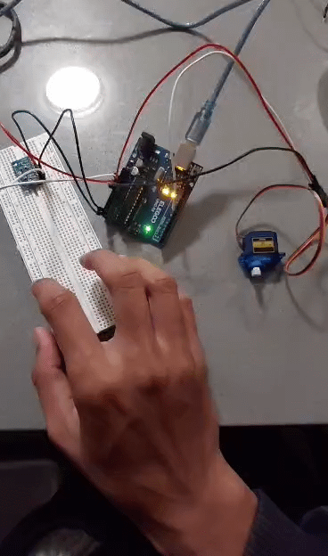

# Motion-Controlled Robotic Actuator

A motion-controlled robotic actuator built using an Arduino Uno, MPU-6500 accelerometer/gyroscope, and SG90 servo motor.

The system detects changes in orientation and translates the sensor's tilt into servo motor movement in real time.

## Hardware Components

- Arduino Uno R3
- MPU-6500 (6-axis accelerometer and gyroscope)
- SG90 Servo Motor
- Breadboard and jumper wires

## How It Works

1. The MPU-6500 detects changes in orientation.
2. The Arduino reads accelerometer data through I2C communication.
3. Roll angles are calculated using the accelerometer readings.
4. The calculated angle is mapped to a servo position between 0° and 180°.
5. The servo continuously responds to changes in sensor orientation.

## Wiring

| Component | Arduino |
|---|---|
| MPU VCC | 3.3V |
| MPU GND | GND |
| MPU SCL | A5 |
| MPU SDA | A4 |
| Servo Signal | D9 |
| Servo VCC | 5V |
| Servo GND | GND |

## Technologies Used

- Arduino C++
- I2C Communication
- MPU-6500 Sensor
- Servo Motor Control

## Author

Tamjeed Ehsan
